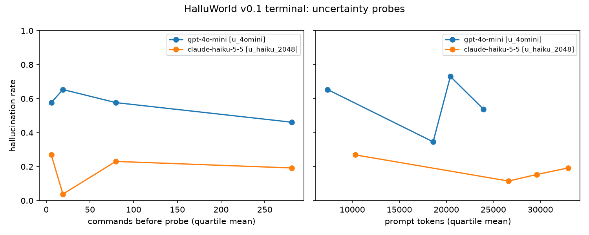

# HalluWorld Depth Analysis

Do HalluWorld's terminal **uncertainty** probes get harder the deeper into a trajectory they are asked?

## Result

On all 104 v0.1 terminal uncertainty probes, neither gpt-4o-mini nor Claude Haiku 5.5 shows hallucination
rising with depth (point-biserial r = +0.02 and −0.06, n = 104 each; Spearman −0.07 and −0.03).

| Run | Model | `max_tokens` | Records | Scored | Excluded | Hit token cap | Hallucination | r with depth (n) |
|---|---|---:|---:|---:|---:|---:|---:|---:|
| `u_4omini` | gpt-4o-mini | 256 | 104 | 104 | 0 | 0 | **59/104 = 56.7%** | +0.02 (104) |
| `u_haiku_2048` | claude-haiku-5-5 | 2048 | 104 | 104 | 0 | 0 | **19/104 = 18.3%** | −0.06 (104) |
| `u_haiku_256` | claude-haiku-5-5 | 256 | 104 | 49 | 55 | 57 | 8/49 = 16.3% ⚠️ | −0.18 (49) ⚠️ |

⚠️ `u_haiku_256` is kept only to show the effect of a low token cap. 57 responses hit the cap: 55 returned no
answer text and the harness excluded them as `empty_response`, and 2 were graded on cut-off answers
(`status=`, `status=un`). The excluded probes are not a random subset. They sit deeper in the trajectory
(median step 66 vs 22) and are harder (21.8% vs 14.3% wrong in the 2048 run), so this run's rate and
correlation are biased. Use `u_haiku_2048` for Haiku.

For reference, HalluWorld's `docs/PROBE_RESULTS.md` (2026-05-04) reports 46.2% accuracy for gpt-4o-mini on
uncertainty probes, i.e. 53.8% hallucination (56/104), vs. 56.7% (59/104) here.



## Method

- **Benchmark:** HalluWorld v0.1.0, commit [`97067122c82f135b6f7526729a849c5ca031e2da`](https://github.com/DegenAI-Labs/HalluWorld/commit/97067122c82f135b6f7526729a849c5ca031e2da),
  terminal track, `--probe-types uncertainty` (104 of the 529 probes). Every manifest records this SHA. The
  Haiku manifests say `dirty: true`; their `dirty_digest` (`6ceac8b1ac90928a`) is exactly the hash of two
  untracked analysis files (`analyze_depth.py`, `depth_plot.png`), so the harness code itself was unmodified.
- **Hallucination** = wrong answers / scored probes. Excluded probes (no answer text, API failure) count in
  neither numerator nor denominator, which is the harness's convention.
- **Depth** = the trigger step (commands executed before the probe). Terminal records leave
  `steps_before_probe` empty, so it is read from the raw v0.1 bank filenames (`..._step-0214_...json`).
- **Correlation** = Pearson r between depth and a 0/1 "hallucinated" flag (the point-biserial correlation),
  over all scored probes. Also shown by quartile, with ±95% normal-approximation intervals.

## Reproduce

```bash
pip install -r requirements.txt
huggingface-cli download DegenAI-Labs/HalluWorld --repo-type dataset --include "v0.1/raw/terminal/*"
python3 analyze_depth.py results/u_4omini/results.jsonl results/u_haiku_2048/results.jsonl
python3 analyze_depth.py results/u_haiku_256/results.jsonl --plot ''
```

To regenerate the raw runs (needs API keys in your environment; copy `.env.example` to `.env`):

```bash
halluworld terminal eval --provider openai    --model gpt-4o-mini      --probe-types uncertainty --max-tokens 256  --out results/u_4omini
halluworld terminal eval --provider anthropic --model claude-haiku-5-5 --probe-types uncertainty --max-tokens 2048 --out results/u_haiku_2048
halluworld terminal eval --provider anthropic --model claude-haiku-5-5 --probe-types uncertainty --max-tokens 256  --out results/u_haiku_256
```

Each `results/<run>/` holds the harness's untouched `results.jsonl` (one record per probe), `summary.json`
and `manifest.json` (config, git SHA, package versions). `u_haiku_256` was originally written as
`u_haiku_test`; only the folder was renamed.

## Limitations

- One trial per probe at default sampling, so each rate has roughly ±10 percentage points of sampling noise
  (95% CI at n = 104).
- Two models, one probe type. This says nothing about other probe types or about models with extended thinking.
- Depth is heavily skewed (2–1643 steps, median 36.5), so the quartile view is more informative than r alone.
- gpt-4o-mini was run at a 256-token cap, the harness default. It never came close (max 9 completion tokens).
